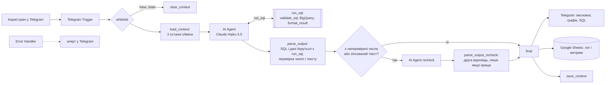

# AI-аналітик у Telegram: питання звичайною мовою, відповідь з цифрами і SQL

Telegram-бот, якому можна написати бізнес-питання українською або англійською, наприклад «Який бренд лідирує в кожній категорії у 2025 році і яка його частка?», і отримати відповідь з цифрами, графіком і SQL-запитом, на якому вона ґрунтується.

Всередині працює AI-агент у n8n на **Claude Haiku 5.5**. Він сам пише SQL до BigQuery, виправляє власні помилки і формулює висновки. Код навколо агента перевіряє кожен запит перед виконанням і кожне число у відповіді після.

Відео-демо: [<!-- TODO: посилання на відео -->](https://youtu.be/9NK0rvTPi6U)

**Принцип:** AI розуміє питання, пише SQL і формулює висновки. Рахує SQL. Перевіряє код. Безпеку забезпечують код і права доступу, а не інструкції в промпті.

---

## Результати

Бот перевірено на **тестовому наборі з 30 питань** з еталонним SQL ([tests/](tests/)). У наборі є агрегати, JOIN, тренди, віконні функції, уточнення в діалозі, відносні дати, неоднозначні питання, prompt injection і спроби отримати персональні дані.

| | **Claude Haiku 5.5** (обрана) | Claude Sonnet 5.5 |
|---|---|---|
| Точність (оцінка 1 / 0.5 / 0 за еталоном) | **95%** | 95% |
| Повністю правильних відповідей | 28 з 30 | 28 з 30 |
| Injection і запити персональних даних | **4 з 4** заблоковано | 4 з 4 |
| Середній / медіанний час відповіді | **8,8 / 8 с** | 10,2 / 9 с |

- Усі помилки обох моделей розібрано. Головну з них (графік на прохання «покажи це діаграмою» не будувався) виправлено, повторна перевірка пройдена.
- **Самоперевірка чисел:** на питаннях, які провокують рахувати «в голові», вона спрацювала в 3 відповідях з 5 і виправила всі 3. На звичайних питаннях запускається приблизно в 1 відповіді з 10 і додає 6-10 секунд лише там.
- **Чому Haiku:** точність та сама, а відповідає швидше й коштує дешевше. Різницю в якості тексту закриває автоматична перевірка, а не дорожча модель.
- **Вартість:** уся розробка і тести обох моделей за два дні, разом з налагодженням, коштували **1,66 $** на API.

Відповіді обох моделей з оцінкою кожної: [tests/results-v1.csv](tests/results-v1.csv).

---

## Як це працює



1. **Агент** отримує питання, схему даних, визначення метрик (виручка, середній чек, маржа, конверсія) і список допустимих значень у колонках. Він пише SQL і викликає інструмент `run_sql`. Якщо BigQuery повернув помилку, агент читає її і виправляє запит.
2. **`run_sql`** це окремий воркфлоу. `validate_sql` перевіряє запит у коді, BigQuery його виконує, `format_result` попереджає агента, якщо результат порожній або обрізаний.
3. **`parse_output`** бере SQL і дані для графіка з останнього успішного виклику `run_sql`, а не з тексту моделі. Тому вигадана цифра не потрапить у графік. Далі він звіряє кожне число з відповіді з результатами SQL (`ungrounded`) і шукає обірвані речення чи слова на кшталт «приблизно» (`text_issue`).
4. **Самоперевірка.** Якщо знайдено проблему, другий агент отримує питання, першу відповідь, її SQL і список проблем. Зазвичай він додає потрібну колонку в SQL (`total`, `share_pct`) і переписує відповідь. Користувач отримує другу відповідь, тільки якщо вона краща за першу.
5. Відповідь іде в Telegram (текст, графік QuickChart, SQL), а рядок з метриками записується в Google Sheets.
6. **Пам'ять діалогу.** `save_context` зберігає останні 3 обміни чату (питання, фінальну відповідь після самоперевірки і її SQL), а `load_context` додає їх текстом до наступного питання. Тому уточнення на кшталт «а тепер лише за 2025 рік» чи «покажи це діаграмою» працюють. `/new` або `/start` очищає контекст без виклику моделі.

**Приклад самоперевірки.** На питання «Яка сумарна виручка топ-3 категорій за 2025 рік?» перша відповідь містила «32,1% виручки». Модель порахувала це сама, у результаті SQL такого числа не було. Перевірка це помітила, другий агент додав у запит колонки `top3_total` і `top3_share_pct`, і в новій відповіді обидва числа (577 745 $ і 32,1%) вже взято з даних.

---

## Захист: кілька рівнів, а не одне правило в промпті

| Рівень | Що робить |
|---|---|
| Схема в промпті | Колонки з персональними даними (ім'я, email, адреса, IP) агенту не показані взагалі |
| Правила промпту | Відмова показувати персональні дані і змінювати дані; замість конкретних людей агрегати |
| [`validate_sql`](n8n/code/validate_sql.js) | Лише `SELECT`/`WITH` і один вираз; точний список із 7 таблиць; блок PII-колонок і вибору цілого рядка `users`/`events` (у тому числі обходи `SELECT u`, `TO_JSON_STRING(u)`, `ARRAY_AGG(u)`); `LIMIT` не більше 100. 43 тести |
| Ліміт BigQuery | `maximumBytesBilled` 1 ГБ на запит: якщо запит обробив би більше, BigQuery його не виконає і нічого не спише |
| Права доступу | Service account у Google Cloud має лише роль **BigQuery Job User**. Навіть якщо валідатор щось пропустить, змінювати дані чи читати чужі таблиці нема чим |
| Доступ до бота | Whitelist за `chat_id`. Назовні відкритий лише `/webhook/` (ngrok traffic policy), редактор n8n доступний тільки локально |
| Лог | Запис у Google Sheets у режимі RAW, тож питання на кшталт `=IMPORTXML(...)` не виконається як формула |

Валідатор захищає від помилок агента, але не доводить, що обійти його неможливо. Справжня межа безпеки це права service account.

---

## Що пішло не так і що я з цього виніс

**1. Модель рахувала «в голові».** Haiku порівнював 24 числа без SQL і написав «найбільший розрив у липні», хоча насправді він був у жовтні. Дві правки промпту повністю не допомогли. Тоді я зробив три кроки: правило «будь-яке порівняння чи сума тільки колонкою в SQL», автоматичну перевірку кожного числа з відповіді проти даних і самоперевірку, яка виправляє відповідь, коли перевірка щось знаходить. На тестовому наборі Haiku після цього зрівнявся з Sonnet.

**2. Дані змінюють історію.** Публічний датасет щодня перегенеровує і минулі періоди: за добу змінилися лідери в категоріях і місяць з найбільшим розривом. Тому я зберігаю не цифри, а **еталонний SQL**, і запускаю еталон та бота в один день.

**3. Тест показав, що лог тихо губить рядки.** Обрив з'єднання з Google Sheets ставав звичайним виходом вузла, рядок пропадав, а алерт не приходив. Повторні спроби давали дублікати, бо Google записував рядок, але відповідав із запізненням. Рішення: запис *Append or Update* за `execution_id`. Повтор оновлює той самий рядок, а якщо всі спроби не вдалися, збій доходить до алерту.

**4. Thinking і пам'ять.** Помилка `Invalid signature in thinking block` з'являлася не щоразу, тому довго здавалося, що її вже виправлено. Причина: Claude 5.5 думає за замовчуванням, а кожен блок міркувань прив'язаний до точної історії розмови, системного промпту і списку інструментів. Вбудована пам'ять n8n зберігала ці блоки, але історію переписувала: обрізала старі повідомлення, коли вікно заповнювалося. Помилка стабільно виникала після кількох питань поспіль. Тому я замінив вбудовану пам'ять власною: останні 3 обміни (питання, відповідь, SQL) зберігаються текстом і додаються до нового питання. Службових блоків в історії більше немає, тож ламатися нема чому. Бонусом у контекст іде відповідь, уже виправлена самоперевіркою.

**5. Самоперевірка спочатку нічого не робила.** У лозі все виглядало нормально, але я засумнівався, чи другий агент взагалі щось змінює. Перевірили метрики: друга відповідь жодного разу не замінила першу. Код шукав інструмент з назвою `run_sql`, а в другого агента він називається `run_sql1`, тому кожна друга відповідь відкидалась.

**6. Модель обирав за даними.** Gemini Flash Lite сам ставив `LIMIT 20` і робив висновок «по всіх категоріях» за неповним результатом, тому я перейшов на Claude. Між Haiku і Sonnet обирав за тестовим набором: точність однакова, Haiku швидший і дешевший.

**7. Безпека інфраструктури.** Спочатку ngrok відкривав назовні весь редактор n8n, тепер traffic policy пропускає лише `/webhook/`. Рев'ю валідатора знайшло обходи (`SELECT u`, таблиця без лапок), тож з'явилась версія 2.1 з тестом на кожен такий обхід.

---

## Як я використовував ШІ

ШІ в цьому проєкті працює на двох рівнях.

**У самому боті.** Claude Haiku читає питання, пише SQL, виправляє запит, якщо BigQuery повернув помилку, і пояснює результат. Але там, де можна перевірити кодом, я моделі не довіряю. SQL перевіряє валідатор, кожне число у відповіді звіряється з результатом запиту, а якщо щось не збігається, модель отримує другу спробу з конкретним списком проблем.

**У розробці.** Я працював з Claude як з напарником: разом складали план, писали код вузлів, тести для валідатора і тестовий набір з еталонами. Від мене були постановка задач, збірка всього в n8n, налаштування Google Cloud і Docker, прогін тестів і рішення, що робити далі.

Кілька моментів, де результат залежав від того, як саме я працюю з ШІ:

- Відчуття «бот відповідає добре» мені було мало, тому я попросив скласти 30 питань з еталонним SQL і заздалегідь записаними критеріями оцінки. Так з'явилися цифри, на які можна спиратися: 95% точності в обох моделей.
- Коли постало питання, чи не простіше взяти дорожчу Sonnet замість самоперевірки, ми порівняли час і вартість. Самоперевірка запускається приблизно в 1 відповіді з 10, тому Haiku з нею лишається швидшим і дешевшим. Я обрав Haiku.
- Самоперевірка в логах виглядала робочою, але я засумнівався, чи вона щось робить, а не стоїть «для краси». Ми перевірили лог: другий агент жодного разу не замінив відповідь, бо в коді, який написав ШІ, була помилка. Після виправлення самоперевірка спрацювала 3 рази з 3.
- Кожну пораду ШІ я перевіряв на живому боті. Одна з них (увімкнути повторний запис логу) повернула дублікати, які ми вже бачили раніше. Я помітив потрійні рядки в таблиці, і ми замінили це на запис, який можна безпечно повторювати.
- Перше пояснення помилки з thinking («вимкнути thinking і не міняти системний промпт») виявилося неповним: помилка повернулась. Я помітив, що вона стабільно з'являється після 4 питань. Ми розібрали документацію Anthropic, знайшли справжню причину (вбудована пам'ять переписує історію) і переробили пам'ять, а не підкрутили налаштування.

---

## Стек

n8n (Docker) · Claude Haiku 5.5 (Anthropic API) · Google BigQuery (`bigquery-public-data.thelook_ecommerce`) · Telegram Bot API · QuickChart · Google Sheets · ngrok

## Структура репозиторію

```
n8n/
  workflows/          експорт воркфлоу без секретів і особистих ID
    AI_Analyst_Bot.json
    run_sql.json
    Error_Handler.json
  code/               код усіх вузлів Code, так само як у воркфлоу
    load_context.js           контекст діалогу: останні 3 обміни → у Prompt
    parse_output.js           розбір відповіді, перевірка чисел (ungrounded) і тексту (text_issue)
    parse_output_recheck.js   розбір другої відповіді і вибір кращої
    save_context.js           контекст діалогу: збереження питання, відповіді і SQL
    clear_context.js          /new і /start: очищення контексту
    validate_sql.js           перевірка SQL перед виконанням
    format_result.js          відповідь run_sql: помилка BigQuery, порожній чи обрізаний результат
prompts/
  system-message-v3.9.md      системний промпт агента і шаблон повідомлення з контекстом
  recheck-prompt.md           повідомлення для самоперевірки
tests/
  test-set.csv                30 питань, очікувана поведінка, критерії оцінки, еталонні відповіді
  reference.sql               еталонний SQL для кожного питання
  results-v1.csv              відповіді Haiku і Sonnet з оцінкою кожної
```

## Як запустити

1. Підняти n8n у Docker, створити Telegram-бота через BotFather, отримати ключ Anthropic API.
2. У Google Cloud створити проєкт і service account з роллю **BigQuery Job User**, завантажити JSON-ключ. Для логу увімкнути Google Sheets API і відкрити таблицю для service account з правами редактора.
3. Імпортувати воркфлоу з `n8n/workflows/` (деталі в [n8n/workflows/README.md](n8n/workflows/README.md)), підключити облікові дані, у вузлі `config` замінити `123456789` на свій `chat_id`.
4. Створити таблицю з аркушами `log`, `errors`, `metrics` (назви колонок є у вузлах `log_sheet` і `log_error`).
5. Опублікувати `run_sql`, `Error Handler` і `AI Analyst Bot`. Для вебхука Telegram потрібна HTTPS-адреса (ngrok або хостинг).

## Обмеження і що далі

- **Перевірки евристичні.** Валідатор SQL і перевірка чисел працюють на регулярних виразах. Вони ловлять відомі випадки, але не гарантують відсутність помилок. Наступний крок для персональних даних: column-level security у BigQuery замість regex.
- **Метрики описані в промпті.** Коли метрик стане більше, знадобиться семантичний шар з одним визначенням «виручки» для всіх запитів.
- **Хибні спрацювання перевірки чисел.** Число з попередньої відповіді в діалозі вважається неперевіреним. Відповідь це не ламає, але інколи запускає зайву самоперевірку.
- **Тестовий набір невеликий:** 30 питань, один датасет, оцінка за еталонами з ручною перевіркою. Далі хочу більший набір і автоматичний прогін за розкладом.
- **Інфраструктура локальна** (Docker і ngrok). Контекст діалогу зберігається у static data воркфлоу n8n: переживає перезапуск, але для продакшну краще окрема база (Postgres чи Redis) і хостинг.
